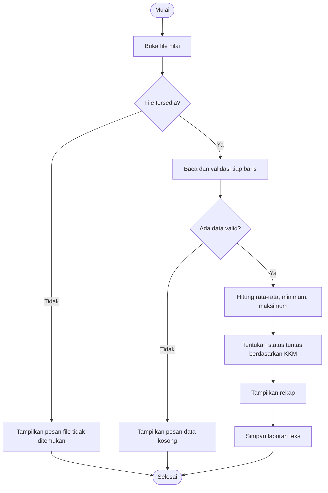

# Pseudocode dan Diagram Alur Utama

## Pseudocode

```text
MULAI
    TENTUKAN file_input, file_output, KKM=75
    COBA baca file_input
    JIKA file tidak ditemukan
        TAMPILKAN pesan error
        SELESAI
    UNTUK setiap baris file
        JIKA baris kosong, LEWATI
        VALIDASI format NIM,nama,nilai
        VALIDASI nilai numerik dalam 0-100
        JIKA invalid, CATAT peringatan dan LEWATI
        SIMPAN baris valid ke list berisi dictionary
    JIKA tidak ada data valid
        TAMPILKAN pesan dan SELESAI
    HITUNG jumlah data, rata-rata, minimum, maksimum
    UNTUK setiap siswa
        TENTUKAN status berdasarkan KKM
    HITUNG jumlah tuntas dan belum tuntas
    TAMPILKAN statistik
    SIMPAN laporan teks ke file_output
SELESAI
```

## Flowchart (Mermaid, bisa dilihat pada pratinjau Markdown GitHub)


